<!-- NAOL MISGANA | KALI LINUX TERMINAL PROFILE -->

<div align="center">


<a href="https://github.com/naol-misgana">

</a>

<br/>


<br/><br/>




</div>

---

### `01` // TECHNICAL SKILLS

<div align="center">


</div>

---

### `02` // PROJECT DIRECTORY

```text
root@naol-kali:~/projects# ls -la
```


### `03` // GITHUB STATISTICS

<div align="center">


</div>

---

### `04` // CONTRIBUTION ACTIVITY

<div align="center">


</div>

---

### `05` // CURRENT OPERATIONS

```text

---
